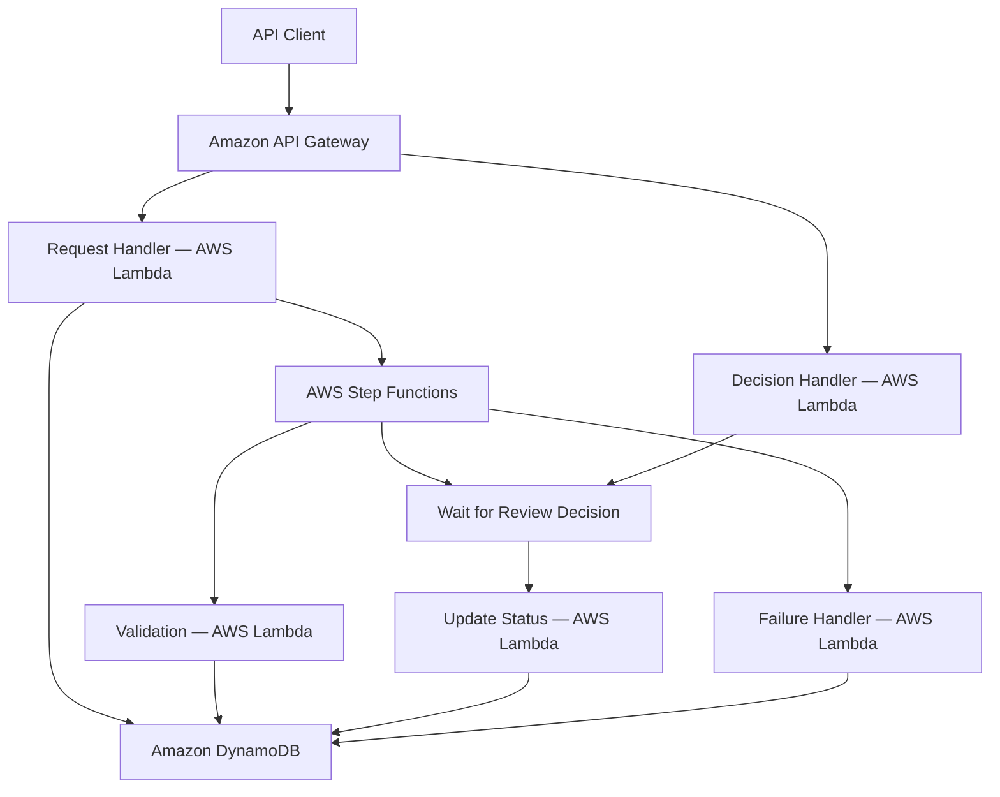

# AWS Customer Onboarding Automation

A serverless reference implementation for validating customer onboarding requests, routing approval decisions, and tracking request status on AWS.

## Business Scenario

A business needs a consistent way to collect onboarding requests and route them for review. This project models that process using an API and an orchestrated workflow, with infrastructure defined through AWS SAM.

## Project Status

In development. This repository currently documents the proposed architecture and implementation scope. AWS deployment and end-to-end verification are pending.

## Planned Features

- Submit an onboarding request through an API.
- Validate required customer and business information.
- Store requests and track their status.
- Route valid requests for approval or rejection.
- Retrieve the current status of a request.
- Handle processing failures with explicit error states.

## Architecture

The proposed workflow uses a Step Functions callback task to wait for a review decision. A decision handler verifies the request state and supplies the approval or rejection result.

## Planned API

| Method | Endpoint | Purpose |
|---|---|---|
| POST | `/requests` | Submit an onboarding request |
| GET | `/requests/{requestId}` | Retrieve request status |
| POST | `/requests/{requestId}/decision` | Submit an approval or rejection |

## Technology

- **Amazon API Gateway:** API endpoints
- **AWS Lambda / Python:** Request handling and workflow tasks
- **AWS Step Functions:** Workflow orchestration
- **Amazon DynamoDB:** Request records and status
- **Amazon CloudWatch:** Logs and operational visibility
- **AWS SAM:** Infrastructure as code

## Design Considerations

- Separate API handling from workflow orchestration.
- Validate input before routing a request for review.
- Use conditional updates to prevent conflicting decisions.
- Keep callback tokens out of API responses and application logs.
- Require authentication and reviewer authorization before exposing decision endpoints.
- Use synthetic data throughout the examples.

## Planned Repository Structure

- `template.yaml` — AWS SAM infrastructure
- `src/` — Lambda application code
- `statemachine/` — Step Functions workflow definition
- `events/` — Sample API events
- `tests/` — Application tests
- `docs/` — Design decisions and operational guidance

## Verification Plan

Verify valid and invalid submissions, approval and rejection paths, duplicate decisions, missing requests, and processing failures.

Deployment instructions, cost considerations, and cleanup steps will be added alongside the implementation.
