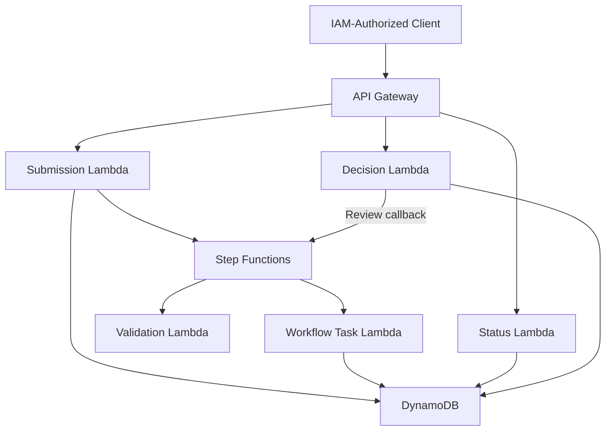

# AWS Customer Onboarding Automation

A serverless reference implementation that accepts customer onboarding requests, validates business information, routes requests for human review, and tracks outcomes.

Built with AWS SAM, API Gateway, Lambda, Step Functions, and DynamoDB.

## Implementation Status

Application code, infrastructure definitions, validation tests, and a CI workflow are included.

AWS deployment and end-to-end verification are pending. Check the repository's Actions tab for the latest automated check results.

## Business Scenario

A business needs a consistent process for collecting onboarding requests and obtaining approval before proceeding.

This project models that process using fictional business customers and synthetic data. Identity verification, credit decisions, and regulatory compliance checks are outside its scope.

## Architecture



## Request Lifecycle

1. An authorized client submits business and contact information.
2. The submission handler validates the input and stores a SUBMITTED request.
3. A Standard Step Functions execution validates the request again.
4. Valid requests enter PENDING_REVIEW.
5. An authorized reviewer submits APPROVED or REJECTED.
6. The decision handler resumes the waiting workflow.
7. The workflow records the final status and removes the callback token.
8. Reviews without a callback expire after 24 hours.

The workflow also includes INVALID and FAILED outcomes.

API validation rejects malformed requests before they are stored. The workflow's INVALID path provides an additional validation boundary.

## API

All endpoints require AWS Signature Version 4 authentication and caller IAM permissions.

| Method | Endpoint | Purpose |
|---|---|---|
| POST | `/requests` | Submit an onboarding request |
| GET | `/requests/{requestId}` | Retrieve status and timestamps |
| POST | `/requests/{requestId}/decision` | Approve or reject a pending request |

### Sample Submission Body

```json
{
  "businessName": "Example Company",
  "contactName": "Jordan Smith",
  "contactEmail": "jordan@example.com"
}
```

### Sample Decision Body

```json
{
  "decision": "APPROVED"
}
```

A successful decision submission returns HTTP 202. The workflow updates the final status asynchronously.

## Repository Structure

- `template.yaml` — AWS SAM infrastructure
- `requirements.txt` — AWS SDK dependency
- `src/submission/app.py` — Request submission
- `src/status/app.py` — Status retrieval
- `src/validation/app.py` — Input validation
- `src/decision/app.py` — Review decision delivery
- `src/workflow/app.py` — Review registration and status transitions
- `statemachine/onboarding.asl.json` — Workflow definition
- `events/valid-request.json` — Synthetic sample input
- `tests/test_validation.py` — Validation unit tests
- `docs/design.md` — Architecture and design decisions
- `.github/workflows/ci.yml` — Automated checks

## Design Decisions

### Separate APIs from orchestration

API handlers accept requests and retrieve status. Step Functions coordinates validation, review, timeout, and outcome persistence.

### Use a callback for human review

The workflow waits for a reviewer instead of repeatedly polling for a decision.

### Protect state transitions

Conditional DynamoDB updates restrict transitions and prevent a conflicting review decision from replacing the first recorded decision.

### Keep sensitive values internal

Status responses exclude customer details and callback tokens. Application code does not log request payloads or tokens. Workflow CloudWatch logging excludes execution data.

Step Functions execution history can still contain sensitive workflow inputs. Access to execution history and the request table must be restricted.

### Require explicit caller permissions

The template enables IAM authentication but does not grant API invocation permissions to callers.

Authorized reviewers need permission to invoke the decision endpoint. Broad execute-api permissions would undermine this separation.

This example does not implement per-customer ownership checks.

## Automated Checks

GitHub Actions is configured to:

- Run validation unit tests.
- Compile Python source files.
- Check workflow JSON syntax.
- Lint the infrastructure template.
- Build the Lambda application packages.

These checks do not verify live AWS behavior or replace integration testing.

## Local Checks

Requirements: Python 3.12 and pip.

```bash
python -m pip install -r requirements.txt aws-sam-cli cfn-lint
python -m unittest discover -s tests -v
python -m compileall -q src tests
python -m json.tool statemachine/onboarding.asl.json
cfn-lint template.yaml
sam build
```

## Optional AWS Deployment

Deployment is not required to inspect this portfolio project.

To deploy, configure AWS credentials with the necessary provisioning permissions, then run:

```bash
sam build
sam deploy --guided
```

Use a unique stack name and a development environment. The template creates IAM roles, so acknowledge the IAM capability when prompted.

After deployment:

1. Retrieve the API URL from the stack outputs.
2. Grant narrowly scoped API invocation permissions to test callers.
3. Use a SigV4-capable client to submit requests.
4. Verify approval, rejection, expiration, and failure behavior.

## Cost Considerations

Potential charges include:

- API Gateway requests
- Lambda requests and execution duration
- Step Functions Standard workflow transitions
- DynamoDB requests and storage
- CloudWatch Logs ingestion and retention
- DynamoDB point-in-time recovery when Environment is prod

Costs depend on region and usage. No fixed cost estimate has been verified.

## Cleanup

```bash
sam delete --stack-name YOUR_STACK_NAME --region YOUR_REGION
```

The template explicitly deletes the request table and application log groups when the stack is deleted. Export any needed records first.

## Known Limitations

- AWS deployment and end-to-end testing are pending.
- Unit tests currently cover input validation only.
- Unconfirmed workflow starts require manual reconciliation.
- Callback delivery and outcome persistence can require reconciliation after partial failures.
- Client submission retries can create duplicate requests.
- Per-customer record authorization is not implemented.
- Monitoring alarms and automated recovery are not implemented.
- Dependencies use a version range rather than a locked build.
- Application packages share the repository root for simplicity.

## Next Improvements

- Add mocked AWS tests for the API and workflow handlers.
- Add submission idempotency.
- Add reconciliation for stalled requests.
- Add operational alarms.
- Verify the complete workflow in an isolated AWS environment.
